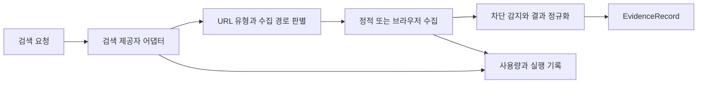

# GomCrawl

여러 검색 API와 웹 수집기를 하나의 근거 수집 파이프라인으로 연결하는 Python 프로젝트입니다. 검색 결과를 얻는 것에서 끝내지 않고, URL 유형 판별·본문 수집·출처 정규화·호출량 기록을 같은 흐름에서 처리합니다.

## 구조



- `core/connectors/`: Naver, Serper, YouTube, Firecrawl, WaterCrawl, Apify 어댑터.
- `core/url_capability_router/`: URL 정규화, 플랫폼 규칙, 응답 유형에 따른 경로 판별.
- `core/crawlers.py`, `core/politeness.py`: 수집기 선택, robots.txt 확인, 호스트별 지연과 재시도 간격.
- `core/schema.py`: 출처를 포함한 공통 결과 구조.
- `core/news_result_cache.py`, `core/usage.py`: 결과 캐시와 사용량 기록.
- `scripts/serve_crawl_dashboard.py`: 로컬 대시보드와 HTTP API.
- `enterpriseDB/enrich_enterprise_db.py`: 기업 식별에 필요한 주소·홈페이지 정규화 코드. 기업 데이터 파일은 포함하지 않습니다.

## 시작

Python 3.10 이상을 사용합니다.

```bash
python3 -m venv .venv
. .venv/bin/activate
python -m pip install -e '.[dev]'
python -m core.cli --help
python -m pytest -q tests
```

정적 페이지 수집:

```bash
python -m core.cli crawl https://example.com --crawler static --local
```

로컬 대시보드:

```bash
python scripts/serve_crawl_dashboard.py --host 127.0.0.1 --port 9101
```

브라우저 수집이 필요하면 `python -m pip install -e '.[playwright]'`와 `python -m playwright install chromium`을 별도로 실행합니다. 검색 제공자는 사용자가 발급한 자격 증명을 환경 변수 또는 해당 `*_FILE` 변수로 전달해야 합니다. 실제 키나 환경 파일은 이 저장소에 없습니다.

기본 실행은 기존 운영 게이트웨이에 연결하지 않습니다. 별도 게이트웨이를 쓰려면 `WEB_SEARCH_GATEWAY_URL`을 명시해야 합니다. 키 파일 자동 탐색은 이 프로젝트의 `key/` 안으로 한정하며, 다른 경로는 명시적인 설정이 필요합니다.

## 검증 범위

공개본의 테스트는 URL 분류, 정규화, 제공자 응답 처리, robots.txt와 요청 지연, 캐시, 차단 감지, 자격 증명 경로 및 게이트웨이 기본값을 검사합니다. 외부 유료 API의 현재 가용성이나 웹사이트별 수집 성공률을 보장하는 테스트는 아닙니다.

## 범위와 한계

이 공개본에는 운영 데이터, 회사 업무 연동, 수집 결과, 모델 가중치와 기존 Git 이력을 포함하지 않습니다. 기사 감성·군집 기능은 별도 모델과 선택 의존성이 필요합니다. 외부 `stealth-browser` 실행 엔진과 WaterCrawl 서버 소스 전체는 포함하지 않으며, 해당 경로는 별도 설치가 필요합니다. 대시보드는 로컬 개발용이며 인터넷에 직접 노출하는 서비스 구성이 아닙니다.

직접 구성한 파이프라인과 외부 제공자·브라우저 엔진의 기여를 구분합니다. 포함된 외부 코드의 고지는 [THIRD_PARTY_NOTICES.md](THIRD_PARTY_NOTICES.md)에 있습니다. 최상위 프로젝트의 재배포 라이선스는 아직 지정하지 않았습니다.
